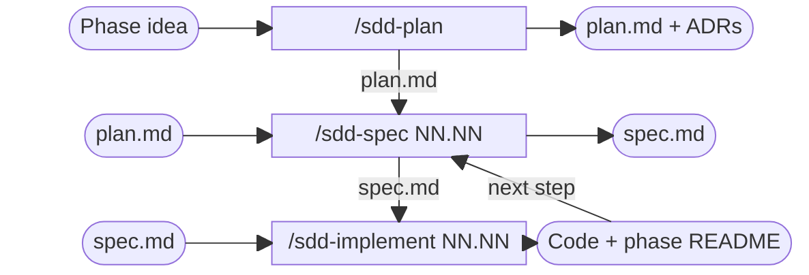

# How to Use SDD

A short, practical guide. Concepts, skills and folder structure are in
[README, section 7](../../README.md#7-development-process-sdd).



## 1. Commands, in Order

```text
/sdd-plan <phase idea>       # once per phase
/sdd-spec 01.01              # then, for each step of the plan, in order:
/sdd-implement 01.01         #   specify, then implement
/sdd-spec 01.02
/sdd-implement 01.02
...
```

## 2. Inputs and Outputs

| Command | Input (you give) | Requires (must exist) | Output (written) |
|---|---|---|---|
| `/sdd-plan` | The phase idea, in free text | — (reads `README.md`, `docs/principles.md`, existing ADRs and plans) | `specs/NN-name/plan.md` (`Approved`); one `docs/decisions/NNN-name.md` per decision (`Accepted`) |
| `/sdd-spec` | The step, as `NN.NN` | `plan.md` `Approved`, with the step in its "Steps" table | `specs/NN-phase/NN-step/spec.md` (`Approved`); step set to `In progress` in `plan.md` |
| `/sdd-implement` | The step, as `NN.NN` | `spec.md` `Approved` | Files listed in the spec; "Result" column filled in and `spec.md` `Implemented`; step section in `specs/NN-phase/README.md`; step `Done` in `plan.md` (last step: end-to-end walkthrough and plan `Done`) |

If the required input is not approved, the command stops.

## 3. Statuses

| Document | Flow |
|---|---|
| `specs/NN-phase/plan.md` | `Approved` → `Done` (after the last step) |
| Step, in the plan's "Steps" table | `To do` → `In progress` (spec approved) → `Done` (step verified) |
| `specs/NN-phase/NN-step/spec.md` | `Approved` → `Implemented` |
| `docs/decisions/NNN-name.md` | `Accepted` → `Superseded by D-NNN` (never rewritten) |

## 4. Your Part at Each Stage

| Stage | You |
|---|---|
| `/sdd-plan` | Answer one question per decision; nothing is saved until all are answered |
| `/sdd-spec` | Approve the spec proposed in chat. A new choice between alternatives goes back to the plan first |
| `/sdd-implement` | Run or confirm costly actions (e.g., `terraform apply`); approve any divergence from the spec (spec and ADR are updated in the same change); follow the step's section in the phase README and confirm |
| After every file change | Review the proposed commit ([AGENTS.md, section 3](../../AGENTS.md#3-git-versioning)) and ask for it to be applied |

If an automated check fails, the agent reports it and stops; nothing is closed until it passes.
